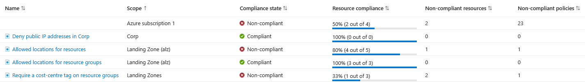

# Lab 02: Azure Policy Guardrails

## Overview

| | |
|---|---|
| **Goal** | Assign Azure Policy guardrails to the management group hierarchy from Lab 01 with Terraform, prove each one blocks what it should, and review what they report about resources that already existed |
| **Runs on** | Azure, at management group level, with Terraform state in Azure Storage |
| **Cost** | Free. Azure Policy has no charge for Azure resources |
| **Time** | About two hours, most of it waiting for compliance scans |

Management groups on their own are just folders. **Azure Policy** is what turns them into a landing zone: rules attached to a management group apply to every subscription and resource beneath it, and Azure enforces them on every request, whether it comes from the portal, the CLI or Terraform.

I assigned four built-in policies at three different levels of the hierarchy, so each test also proves that inheritance works.



The first row is Microsoft Defender for Cloud's default assignment, which Azure adds to every subscription. I hid its name because it contains my subscription ID.

---

## Architecture

```
Landing Zone (alz)                mg-alz
│   ├── Allowed locations for resources          (uksouth, ukwest)
│   └── Allowed locations for resource groups    (uksouth, ukwest)
│
└── Landing Zones                 mg-alz-landingzones
    │   └── Require a cost-centre tag on resource groups
    │
    └── Corp                      mg-alz-corp
        │   └── Deny public IP addresses
        │
        └── Azure subscription 1  ← inherits all four
```

| Assignment | Assigned at | Why it is there |
|---|---|---|
| `alz-allowed-locations` | `mg-alz` | Keeps resources in UK regions, for data residency and predictable costs |
| `alz-allowed-rg-locations` | `mg-alz` | Does the same for resource groups, which hold their own metadata in a region |
| `lz-require-rg-tag` | `mg-alz-landingzones` | Every application team's resource group must say which cost centre pays for it |
| `corp-deny-public-ip` | `mg-alz-corp` | Corp workloads are internal only. Internet access goes through the hub network built in Lab 03 |

The location rules sit at the top because they apply to everything. The tag rule sits at Landing Zones because it is about application teams, not the platform. The public IP rule sits at Corp only, because Online landing zones are meant to be internet-facing.

All four use the **Deny** effect, so a request that breaks a rule is rejected before anything is created.

---

## Following along?

- I ran every command in **PowerShell** on Windows, using the terminal inside **VS Code**.
- Each command is in its own box. Run **one line at a time**.
- Boxes marked **What I saw** show my output. They are not commands to run.
- I have removed my subscription ID and tenant ID from every output.
- This lab needs the management group hierarchy from [Lab 01](../lab-01-management-groups/README.md).

See the [main README prerequisites](../README.md#prerequisites) for what to install.

---

## Files in this lab

| File | What it does |
|---|---|
| `providers.tf` | The Terraform and azurerm provider versions |
| `backend.tf` | Stores Terraform state in Azure Storage, in its own state file |
| `variables.tf` | The organisation prefix, allowed regions, required tag name and blocked resource types |
| `main.tf` | Looks up the management groups and built-in policies, then creates the four assignments |
| `outputs.tf` | Each assignment and the management group it is attached to |

### Variables

| Variable | Default | What it controls |
|---|---|---|
| `prefix` | `alz` | Finds the management groups built in Lab 01 |
| `allowed_locations` | `["uksouth", "ukwest"]` | The approved regions, used by both location policies |
| `required_tag` | `cost-centre` | The tag every landing zone resource group must have |
| `corp_denied_resource_types` | `["Microsoft.Network/publicIPAddresses"]` | Resource types blocked in Corp |

### One assignment from `main.tf`

The other three follow the same pattern.

```hcl
# Look up the Corp management group created in Lab 01
data "azurerm_management_group" "corp" {
  name = "mg-${var.prefix}-corp"
}

# Built-in policy: Not allowed resource types
data "azurerm_policy_definition" "not_allowed_types" {
  name = "6c112d4e-5bc7-47ae-a041-ea2d9dccd749"
}

resource "azurerm_management_group_policy_assignment" "corp_deny_types" {
  name                 = "corp-deny-public-ip"
  display_name         = "Deny public IP addresses in Corp"
  description          = "Corp landing zones are internal only and reach the internet through the hub."
  management_group_id  = data.azurerm_management_group.corp.id
  policy_definition_id = data.azurerm_policy_definition.not_allowed_types.id

  parameters = jsonencode({
    effect                        = { value = "Deny" }
    listOfResourceTypesNotAllowed = { value = var.corp_denied_resource_types }
  })

  non_compliance_message {
    content = "Public IP addresses are not allowed in Corp landing zones. Internet access goes through the hub network."
  }
}
```

| Code | What it does |
|---|---|
| `data "azurerm_management_group"` | Finds a management group from Lab 01 by name. This lab reads the hierarchy but does not own it, so Lab 01's state is never touched |
| `data "azurerm_policy_definition"` | Looks up a built-in policy by its fixed ID, so the assignment points at Microsoft's definition rather than a copy |
| `name = "corp-deny-public-ip"` | Assignment names at management group scope are limited to 24 characters, so I kept them short and used `display_name` for the readable version |
| `parameters = jsonencode({...})` | Policy parameters are JSON. `jsonencode` builds that JSON from Terraform values, so the list of blocked types comes from a variable |
| `effect = { value = "Deny" }` | Sets the effect explicitly instead of relying on the built-in default |
| `non_compliance_message` | The message a person sees when they are blocked. It explains the rule and points them to the right approach |

---

## How I built it

### Step 1: Checked I was still signed in

```powershell
az account show --query name -o tsv
```

**What I saw:**

```
Azure subscription 1
```

```powershell
$env:ARM_SUBSCRIPTION_ID = az account show --query id -o tsv
```

### Step 2: Initialised and planned

```powershell
cd C:\azure-landing-zone\lab-02-policy
```

```powershell
terraform init
```

```powershell
terraform fmt
```

```powershell
terraform validate
```

```powershell
terraform plan -out=tfplan
```

**What I saw** (shortened):

```
data.azurerm_management_group.org: Read complete after 0s [id=/providers/Microsoft.Management/managementGroups/mg-alz]
data.azurerm_policy_definition.allowed_locations: Read complete after 0s [id=/providers/Microsoft.Authorization/policyDefinitions/e56962a6-4747-49cd-b67b-bf8b01975c4c]
...
  # azurerm_management_group_policy_assignment.allowed_locations will be created
  # azurerm_management_group_policy_assignment.allowed_rg_locations will be created
  # azurerm_management_group_policy_assignment.corp_deny_types will be created
  # azurerm_management_group_policy_assignment.require_rg_tag will be created

Plan: 4 to add, 0 to change, 0 to destroy.
```

Before applying, I checked what the plan would do to resources I already had. A Deny policy only checks **create and update requests**. It never deletes or changes an existing resource, so my existing resource groups would stay, but they would be reported as non-compliant.

### Step 3: Applied

```powershell
terraform apply tfplan
```

**What I saw:**

```
Apply complete! Resources: 4 added, 0 changed, 0 destroyed.

Outputs:

assignments = {
  "allowed_locations" = "alz-allowed-locations at mg-alz"
  "allowed_rg_locations" = "alz-allowed-rg-locations at mg-alz"
  "corp_deny_types" = "corp-deny-public-ip at mg-alz-corp"
  "require_rg_tag" = "lz-require-rg-tag at mg-alz-landingzones"
}
```

### Step 4: Checked the assignments in Azure

```powershell
az policy assignment list --scope "/providers/Microsoft.Management/managementGroups/mg-alz" --query "[].{Name:name, Display:displayName}" -o table
```

**What I saw:**

```
Name                      Display
------------------------  -------------------------------------
alz-allowed-rg-locations  Allowed locations for resource groups
alz-allowed-locations     Allowed locations for resources
```

I ran the same command for `mg-alz-landingzones` and `mg-alz-corp`, which showed `lz-require-rg-tag` and `corp-deny-public-ip`. Each management group lists only the assignments made **directly** on it. See [Issue 1](#1-the-cli-did-not-show-inherited-assignments).

---

## Tests I carried out

Each test breaks exactly one rule, so only one policy can be responsible for the result.

### Test 1: A resource group outside the UK

The tag is included on purpose, so only the location rule can block it.

```powershell
az group create --name rg-alz-policy-test --location westeurope --tags cost-centre=lab
```

**What I saw** (shortened):

```
(RequestDisallowedByPolicy) Resource 'rg-alz-policy-test' was disallowed by policy. Reasons: 'Resource groups must be created in an approved region: uksouth, ukwest.'.
...
            {
                "expression": "location",
                "expressionValue": "westeurope",
                "targetValue": [ "uksouth", "ukwest" ],
                "operator": "NotIn"
            }
...
    "policyAssignmentName": "alz-allowed-rg-locations",
    "policyAssignmentScope": "/providers/Microsoft.Management/managementGroups/mg-alz",
```

Azure blocked the request and returned my custom message. The `evaluatedExpressions` section shows exactly why: `westeurope` was not in the allowed list. The assignment is on `mg-alz`, two levels above my subscription, so this also proves inheritance.

### Test 2: A resource group without the cost-centre tag

**2a. Without the tag, in an allowed region:**

```powershell
az group create --name rg-alz-policy-test --location uksouth
```

**What I saw** (shortened):

```
(RequestDisallowedByPolicy) Resource 'rg-alz-policy-test' was disallowed by policy. Reasons: 'Resource groups in a landing zone must have a 'cost-centre' tag.'.
...
    "policyAssignmentName": "lz-require-rg-tag",
    "policyAssignmentScope": "/providers/Microsoft.Management/managementGroups/mg-alz-landingzones",
```

**2b. With the tag:**

```powershell
az group create --name rg-alz-policy-test --location uksouth --tags cost-centre=lab --query "{Name:name, Location:location, Tags:tags}" -o json
```

**What I saw:**

```json
{
  "Location": "uksouth",
  "Name": "rg-alz-policy-test",
  "Tags": {
    "cost-centre": "lab"
  }
}
```

The same request succeeded once it followed the rule. A guardrail should block only what breaks it, not slow down everything else.

### Test 3: A public IP in Corp

```powershell
az network public-ip create --resource-group rg-alz-policy-test --name pip-alz-policy-test --location uksouth --sku Standard
```

**What I saw** (shortened):

```
(RequestDisallowedByPolicy) Resource 'pip-alz-policy-test' was disallowed by policy. Reasons: 'Public IP addresses are not allowed in Corp landing zones. Internet access goes through the hub network.'.
```

This is the guardrail that matters most in a real Corp landing zone. It stops anyone exposing a workload directly to the internet, whichever tool they use.

I then removed the test resource group:

```powershell
az group delete --name rg-alz-policy-test --yes
```

```powershell
az group exists --name rg-alz-policy-test
```

```
false
```

| Test | Blocked by | Assigned at |
|---|---|---|
| Resource group in `westeurope` | `alz-allowed-rg-locations` | `mg-alz` |
| Resource group without `cost-centre` | `lz-require-rg-tag` | `mg-alz-landingzones` |
| Public IP | `corp-deny-public-ip` | `mg-alz-corp` |

### Test 4: Compliance of resources that already existed

Deny stops new problems. The other half of Azure Policy is reporting on what was already there. I ran a compliance scan and waited for it to finish:

```powershell
az policy state trigger-scan
```

```powershell
az policy state list --filter "policyAssignmentName ne 'SecurityCenterBuiltIn'" --query "[].{Assignment:policyAssignmentName, State:complianceState, Group:resourceGroup, Type:resourceType}" -o table
```

**What I saw:**

```
Assignment                State         Group             Type
------------------------  ------------  ----------------  ------------------------------------------------
alz-allowed-locations     Compliant     rg-tfstate-uks    Microsoft.Storage/storageAccounts
alz-allowed-rg-locations  Compliant     rg-tfstate-uks    Microsoft.Resources/subscriptions/resourceGroups
lz-require-rg-tag         NonCompliant  rg-tfstate-uks    Microsoft.Resources/subscriptions/resourceGroups
alz-allowed-rg-locations  Compliant     rg-migrate-lab2   Microsoft.Resources/subscriptions/resourceGroups
alz-allowed-rg-locations  Compliant     NetworkWatcherRG  Microsoft.Resources/subscriptions/resourceGroups
lz-require-rg-tag         NonCompliant  rg-migrate-lab2   Microsoft.Resources/subscriptions/resourceGroups
lz-require-rg-tag         NonCompliant  NetworkWatcherRG  Microsoft.Resources/subscriptions/resourceGroups
alz-allowed-locations     Compliant     rg-migrate-lab2   Microsoft.Network/virtualNetworks
alz-allowed-locations     Compliant     rg-migrate-lab2   Microsoft.Network/virtualNetworks
alz-allowed-locations     Compliant     NetworkWatcherRG  Microsoft.Network/networkWatchers
alz-allowed-locations     NonCompliant  NetworkWatcherRG  Microsoft.Network/networkWatchers
```

None of these resources was changed or deleted. Azure reported them and left them alone:

- All three resource groups were created before the policy, so none had a `cost-centre` tag.
- One Network Watcher was outside the UK. Azure creates a Network Watcher automatically in each region where a virtual network is created, and I found where it came from:

```powershell
az network watcher list --query "[].{Name:name, Location:location}" -o table
```

```
Name                          Location
----------------------------  -------------
NetworkWatcher_uksouth        uksouth
NetworkWatcher_swedencentral  swedencentral
```

The Sweden Central watcher was left behind by [Kubernetes Lab 05](https://github.com/iM-MQ/kubernetes-labs/tree/main/lab-05-aks), where I built an AKS cluster in Sweden Central.

`corp-deny-public-ip` does not appear in the table because there were no public IPs for it to evaluate.

### Fixing one finding

The state storage resource group is a platform resource I own, so I fixed it. I kept the resource ID in a variable so my subscription ID stayed off the screen:

```powershell
$rgId = az group show --name rg-tfstate-uks --query id -o tsv
```

```powershell
az tag update --resource-id $rgId --operation Merge --tags cost-centre=platform --query properties.tags -o json
```

`Merge` adds the tag and keeps any that are already there. Adding a tag is an update request, so policy checked it, and allowed it because the result had the required tag.

```powershell
az policy state trigger-scan --resource-group rg-tfstate-uks
```

```powershell
az policy state list --resource-group rg-tfstate-uks --filter "policyAssignmentName ne 'SecurityCenterBuiltIn'" --query "[].{Assignment:policyAssignmentName, State:complianceState, Type:resourceType}" -o table
```

**What I saw:**

```
Assignment                State      Type
------------------------  ---------  ------------------------------------------------
alz-allowed-locations     Compliant  Microsoft.Storage/storageAccounts
alz-allowed-rg-locations  Compliant  Microsoft.Resources/subscriptions/resourceGroups
lz-require-rg-tag         Compliant  Microsoft.Resources/subscriptions/resourceGroups
```

That completed the full cycle: the guardrail reported the problem, I fixed it with a change the policy allows, and a re-scan confirmed the fix.

### Known findings I left in place

| Resource | Finding | Why I left it |
|---|---|---|
| `NetworkWatcherRG` | No `cost-centre` tag | Created automatically by Azure |
| `NetworkWatcher_swedencentral` | Outside the allowed regions | Left over from Kubernetes Lab 05 |
| `rg-migrate-lab2` | No `cost-centre` tag | Belongs to a separate piece of work, outside this project |

In a real organisation, each of these would either be fixed or given a **policy exemption**, which records the reason, a category (Waiver or Mitigated) and an expiry date, so the exception is visible and reviewed rather than forgotten.

---

## Issues I hit and how I fixed them

### 1. The CLI did not show inherited assignments

**Symptom.** I expected `az policy assignment list` on `mg-alz-corp` to show all four assignments that apply there. It showed only `corp-deny-public-ip`. Adding `--disable-scope-strict-match` at subscription level showed only Defender for Cloud's default assignment.

**Root cause.** By default, `az policy assignment list --scope` uses strict scope matching and returns only the assignments made directly on that scope.

**Fix.** I used better evidence instead. Every deny error includes `policyAssignmentScope`, which showed rules from `mg-alz` and `mg-alz-landingzones` blocking requests in my subscription. The Compliance page in the portal also lists every assignment that applies, with the scope it comes from.

**Lesson.** The strongest proof that a guardrail is inherited is a request that it blocks, not a list that says it exists.

### 2. The compliance report only showed Defender for Cloud results

**Symptom.** Straight after starting a scan, every non-compliant result belonged to `SecurityCenterBuiltIn`, and none of my assignments appeared.

**Root cause.** I had started the scan with `--no-wait`, which returns immediately while the scan carries on in Azure. I checked before Azure had evaluated my new assignments. Microsoft's documentation says a new assignment takes about five minutes to apply before evaluation starts, with no fixed time for the evaluation to finish.

**Fix.** I ran `az policy state trigger-scan` without `--no-wait`, so the command only returned once the scan had finished. I also filtered out `SecurityCenterBuiltIn`, which is Defender for Cloud's audit-only assignment and not part of this lab.

### 3. My subscription ID appeared in the portal screenshot

**Symptom.** Defender for Cloud's default assignment is named `ASC Default (subscription: <id>)`, so it showed part of my subscription ID on the Compliance page.

**Fix.** I covered the name in Paint before saving the screenshot, and checked the rest of the image for my email address and account picture.

**Lesson.** Check every screenshot before publishing it. IDs appear in places you do not expect, including resource names that Azure creates for you.

---

## Clean up

The assignments stay in place for Labs 03 and 04, so everything I build next must follow them: UK regions only, a `cost-centre` tag on every resource group, and no public IPs in Corp.

At the end of the project I run `terraform destroy` in this lab **before** Lab 01, so the assignments are removed before the management groups they are attached to.

---

## Command reference

| Command | What it does |
|---|---|
| `az policy assignment list --scope <scope>` | Lists the policy assignments made directly on a scope |
| `az policy state trigger-scan` | Starts a compliance scan of the subscription and waits for it to finish |
| `az policy state trigger-scan --resource-group <name>` | Scans one resource group |
| `az policy state list --filter "<condition>"` | Lists compliance results, filtered by state or assignment |
| `az tag update --resource-id <id> --operation Merge --tags <key>=<value>` | Adds tags without removing existing ones |
| `az network watcher list` | Lists Network Watchers and their regions |

## What I learned

- Azure Policy turns the management group hierarchy into a set of enforced rules. Where a rule is assigned decides who it applies to.
- Deny blocks new and updated resources but never touches existing ones. Those are reported as non-compliant, which makes the compliance report a clean-up list.
- Testing one rule at a time, with everything else valid, proves which guardrail is responsible for each result.
- A clear `non_compliance_message` turns a blocked request into an explanation of the rule and the right way to do it.
- Compliance data is not instant. A scan has to finish before new assignments show results.
- Exceptions should be formal policy exemptions with a reason and an expiry date, not something left quietly non-compliant.

---

## References

Official documentation I used while building and testing this lab.

| What I did | Documentation |
|---|---|
| Learned how Azure Policy works | [What is Azure Policy?](https://learn.microsoft.com/en-us/azure/governance/policy/overview) |
| Chose the four built-in policies | [Built-in policy definitions](https://learn.microsoft.com/en-us/azure/governance/policy/samples/built-in-policies) |
| Understood what Deny does to new and existing resources | [Azure Policy definitions deny effect](https://learn.microsoft.com/en-us/azure/governance/policy/concepts/effect-deny) |
| Created the assignments with Terraform | [azurerm_management_group_policy_assignment](https://registry.terraform.io/providers/hashicorp/azurerm/latest/docs/resources/management_group_policy_assignment) |
| Looked up built-in policies by ID | [azurerm_policy_definition data source](https://registry.terraform.io/providers/hashicorp/azurerm/latest/docs/data-sources/policy_definition) |
| Built the policy parameters | [jsonencode function](https://developer.hashicorp.com/terraform/language/functions/jsonencode) |
| Listed the assignments from the CLI | [az policy assignment](https://learn.microsoft.com/en-us/cli/azure/policy/assignment?view=azure-cli-latest) |
| Ran compliance scans and read the results | [Get policy compliance data](https://learn.microsoft.com/en-us/azure/governance/policy/how-to/get-compliance-data) |
| Used `trigger-scan` and `list` | [az policy state](https://learn.microsoft.com/en-us/cli/azure/policy/state?view=azure-cli-latest) |
| Added the missing tag | [Apply tags with Azure CLI](https://learn.microsoft.com/en-us/azure/azure-resource-manager/management/tag-resources-cli) |
| Found where the Sweden Central Network Watcher came from | [Enable or disable Azure Network Watcher](https://learn.microsoft.com/en-us/azure/network-watcher/network-watcher-create) |
| Planned how to handle the known findings | [Azure Policy exemption structure](https://learn.microsoft.com/en-us/azure/governance/policy/concepts/exemption-structure) |