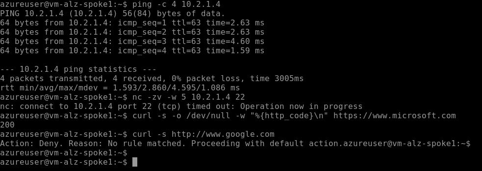

# Lab 03: Hub-and-Spoke Networking

## Overview

| | |
|---|---|
| **Goal** | Build a hub-and-spoke network with Terraform, with Azure Firewall and Bastion in the hub, force all spoke traffic through the firewall, and make it work inside the Azure Policy guardrails from Lab 02 |
| **Runs on** | Azure, in UK West, with Terraform state in Azure Storage |
| **Cost** | About £1.40 an hour while running, mostly Azure Firewall. I built, tested and destroyed it in one sitting |
| **Time** | About three hours, including checking what the free trial allows |

The hub-and-spoke model is the network design in Microsoft's Cloud Adoption Framework. Shared services, such as the firewall and remote access, live in one **hub** network. Each workload gets its own **spoke** network, connected only to the hub. Spokes cannot reach each other or the internet except through the hub's firewall, so all traffic passes through one place that applies the rules.

This lab also had to work **inside** the guardrails from Lab 02. The firewall and Bastion both need public IP addresses, which Lab 02 blocks in Corp, so I added a formal, time-limited **policy exemption** for the hub only.



---

## Architecture

```
                          Internet
                             │
          ┌──────────────────┴────────────────────┐
          │  Hub VNet  10.0.0.0/16                │  rg-alz-hub-ukw
          │  ├── AzureFirewallSubnet  10.0.1.0/26 │  Firewall  10.0.1.4
          │  └── AzureBastionSubnet   10.0.2.0/26 │  Bastion
          │                                       │  Policy exemption: public IPs allowed here only
          └──────┬───────────────────────┬────────┘
          peering│                       │peering
   ┌─────────────┴──────────┐ ┌──────────┴─────────────┐
   │ Spoke 1  10.1.0.0/16   │ │ Spoke 2  10.2.0.0/16   │
   │ snet-workload 10.1.1.0 │ │ snet-workload 10.2.1.0 │
   │ NSG + route table      │ │ NSG + route table      │
   │ vm-alz-spoke1 10.1.1.4 │ │ vm-alz-spoke2 10.2.1.4 │
   └────────────────────────┘ └────────────────────────┘
        0.0.0.0/0 → 10.0.1.4 (the firewall) from both spokes
```

| Resource group | Contents | `cost-centre` |
|---|---|---|
| `rg-alz-hub-ukw` | Hub VNet, Azure Firewall (Standard) and firewall policy, Azure Bastion (Basic), the policy exemption | `platform` |
| `rg-alz-spoke1-ukw` | Spoke 1 VNet, NSG, route table, test VM | `app1` |
| `rg-alz-spoke2-ukw` | Spoke 2 VNet, NSG, route table, test VM | `app2` |

| Control | What it allows |
|---|---|
| **Firewall network rule** | Ping (ICMP) between the two spokes, and nothing else |
| **Firewall application rule** | HTTP and HTTPS from the spokes to `*.ubuntu.com` and `www.microsoft.com` only |
| **NSG on each spoke** | SSH from the Bastion subnet, ping from the spokes, and nothing else from any connected network |
| **Route table on each spoke** | Sends everything outside the spoke and the hub to the firewall |
| **Policy exemption** | Public IPs in the hub resource group only, until 30 November 2026 |

### Why UK West

My guardrails allow `uksouth` and `ukwest`. My free trial subscription blocks every VM size in UK South but allows many in UK West, so the whole lab runs in UK West. See [Issue 1](#1-no-vm-sizes-were-available-in-uk-south).

---

## Following along?

- I ran every command in **PowerShell** on Windows, using the terminal inside **VS Code**. Commands inside the test VM ran in **Bash**, through Bastion.
- Each command is in its own box. Run **one line at a time**.
- Boxes marked **What I saw** show my output. They are not commands to run.
- I have removed my subscription ID and tenant ID from every output.
- This lab needs the management groups from [Lab 01](../lab-01-management-groups/README.md) and the policies from [Lab 02](../lab-02-policy/README.md).
- **Azure Firewall is expensive.** Run `terraform destroy` as soon as you finish testing.

See the [main README prerequisites](../README.md#prerequisites) for what to install.

---

## Files in this lab

| File | What it does |
|---|---|
| `providers.tf` | The Terraform and azurerm provider versions, copied from Lab 02 |
| `backend.tf` | Stores Terraform state in Azure Storage, in its own state file |
| `variables.tf` | Region, address spaces, the spokes map, VM size, SSH key path, exemption expiry and approved websites, with validation |
| `hub.tf` | The policy exemption, hub network, firewall and its policy, and Bastion |
| `spokes.tf` | Both spokes from one map: networks, peering, route tables and NSGs |
| `vms.tf` | One test VM per spoke, with no public IP |
| `outputs.tf` | Firewall private IP, VM private IPs, Bastion name and the exemption expiry |

Splitting the configuration across several files is only for readability. Terraform reads every `.tf` file in the folder as one configuration.

### The policy exemption, from `hub.tf`

```hcl
# Lab 02 blocks public IPs in Corp. Azure Firewall and Bastion each need one,
# so the hub resource group gets a time-limited exemption from that one rule.
locals {
  corp_deny_public_ip_assignment_id = "/providers/Microsoft.Management/managementGroups/mg-${var.prefix}-corp/providers/Microsoft.Authorization/policyAssignments/corp-deny-public-ip"
}

resource "azurerm_resource_group_policy_exemption" "hub_public_ips" {
  name                 = "hub-public-ips"
  display_name         = "Hub firewall and Bastion public IPs"
  description          = "Azure Firewall and Azure Bastion need public IPs. Allowed in the hub resource group only, until the expiry date."
  resource_group_id    = azurerm_resource_group.hub.id
  policy_assignment_id = local.corp_deny_public_ip_assignment_id
  exemption_category   = "Waiver"
  expires_on           = var.exemption_expires_on
}

# The exemption must exist before Azure is asked for a public IP
resource "azurerm_public_ip" "firewall" {
  name                = "pip-${var.prefix}-fw-${var.location_short}"
  location            = azurerm_resource_group.hub.location
  resource_group_name = azurerm_resource_group.hub.name
  allocation_method   = "Static"
  sku                 = "Standard"

  depends_on = [azurerm_resource_group_policy_exemption.hub_public_ips]
}
```

| Code | What it does |
|---|---|
| `resource_group_id = azurerm_resource_group.hub.id` | Scopes the exemption to the hub resource group only. The spokes stay fully covered by Lab 02 |
| `policy_assignment_id` | Exempts one assignment, `corp-deny-public-ip`. The location and tag rules still apply to the hub |
| `exemption_category = "Waiver"` | Records that the non-compliance is accepted on purpose. The other category, `Mitigated`, means the rule's intent is met another way |
| `expires_on` | The exception ends on a fixed date, so it must be reviewed rather than forgotten |
| `depends_on` | Nothing in the public IP refers to the exemption, so Terraform cannot work out the order on its own. Without this, it could request the public IP first and be denied |

### The spokes, from `spokes.tf`

```hcl
# Send everything that is not local or in the hub to the firewall
resource "azurerm_route_table" "spoke" {
  for_each = var.spokes

  name                          = "rt-${var.prefix}-${each.key}-${var.location_short}"
  location                      = azurerm_resource_group.spoke[each.key].location
  resource_group_name           = azurerm_resource_group.spoke[each.key].name
  bgp_route_propagation_enabled = false

  route {
    name                   = "default-via-firewall"
    address_prefix         = "0.0.0.0/0"
    next_hop_type          = "VirtualAppliance"
    next_hop_in_ip_address = azurerm_firewall.hub.ip_configuration[0].private_ip_address
  }
}
```

| Code | What it does |
|---|---|
| `for_each = var.spokes` | Builds every spoke resource once per entry in the map. Adding a third spoke means adding one line to `variables.tf` |
| `address_prefix = "0.0.0.0/0"` | Replaces Azure's built-in default route to the internet |
| `next_hop_type = "VirtualAppliance"` | Sends that traffic to a device inside the network, here the firewall |
| `azurerm_firewall.hub.ip_configuration[0].private_ip_address` | The firewall's private IP, read from the firewall itself rather than typed in |
| `bgp_route_propagation_enabled = false` | Stops routes learned from a VPN or ExpressRoute gateway overriding this one |
| `allow_forwarded_traffic = true` (on the peerings) | Lets each network accept traffic the firewall forwards on behalf of another network |
| `deny-other-vnet-inbound` (NSG, priority 4000) | Overrides Azure's default rule that allows all traffic between connected networks |

### The test VMs, from `vms.tf`

| Setting | Why |
|---|---|
| `size = "Standard_F1als_v7"` | The smallest size my free trial allows in UK West: 1 vCPU and 2 GB of memory |
| `disk_controller_type = "NVMe"` | v7 sizes only support the NVMe disk controller. The default, SCSI, would fail |
| Ubuntu 24.04 LTS, Gen2 | v7 sizes need a Gen2 image that is marked as supporting NVMe |
| `admin_ssh_key` from `~/.ssh/alz-lab03.pub` | SSH keys only, with no password. The key is stored outside the repository |
| No public IP | The VMs are reached only through Bastion |

---

## How I built it

### Step 1: Checked which VM sizes the free trial allows

My location policy only allows UK regions, so I checked VM availability there before writing any code. `az vm list-skus` hides sizes that are blocked for the subscription unless you add `--all`, so the plain command lists only what is available:

```powershell
(az vm list-skus --location uksouth --resource-type virtualMachines --query "[].name" -o tsv | Measure-Object).Count
```

```powershell
(az vm list-skus --location ukwest --resource-type virtualMachines --query "[].name" -o tsv | Measure-Object).Count
```

**What I saw:**

```
0
263
```

UK West it was. I then checked my vCPU quota there and what the smallest size needs:

```powershell
az vm list-usage --location ukwest --output table | Select-String "Total Regional vCPUs", "Falsv7"
```

```
Total Regional vCPUs                      0               4
Standard Falsv7 Family vCPUs              0               4
```

```powershell
az vm list-skus --location ukwest --size Standard_F1als_v7 --query "[0].capabilities[].[name, value]" -o tsv
```

**What I saw** (shortened):

```
vCPUs   1
HyperVGenerations       V2
DiskControllerTypes     NVMe
MemoryGB        2
```

Two of these VMs use 2 of my 4 vCPUs. The size only supports **Gen2 images** and the **NVMe** disk controller, so I checked the Ubuntu image supported both:

```powershell
az vm image show --location ukwest --urn Canonical:ubuntu-24_04-lts:server:latest --query "{Gen:hyperVGeneration, Features:features}" -o json
```

**What I saw** (shortened):

```json
{
  "Features": [
    { "name": "DiskControllerTypes", "value": "SCSI, NVMe" }
  ],
  "Gen": "V2"
}
```

### Step 2: Created the folder and an SSH key

```powershell
cd C:\azure-landing-zone
```

```powershell
New-Item -ItemType Directory -Path lab-03-hub-spoke
```

```powershell
Copy-Item lab-02-policy\providers.tf, lab-02-policy\backend.tf -Destination lab-03-hub-spoke
```

```powershell
(Get-Content lab-03-hub-spoke\backend.tf) -replace 'alz-lab02-policy.tfstate', 'alz-lab03-hub-spoke.tfstate' | Set-Content lab-03-hub-spoke\backend.tf
```

```powershell
New-Item -ItemType Directory -Path "$HOME\.ssh"
```

```powershell
ssh-keygen -t rsa -b 4096 -f "$HOME\.ssh\alz-lab03" -C "alz-lab03"
```

The `.ssh` folder step is there because the first attempt failed. See [Issue 2](#2-ssh-keygen-could-not-save-the-key).

### Step 3: Initialised, validated and planned

```powershell
cd C:\azure-landing-zone\lab-03-hub-spoke
```

```powershell
terraform init
```

```powershell
terraform fmt
```

```powershell
terraform validate
```

```powershell
terraform plan -out=tfplan | Select-String "will be created", "Plan:"
```

**What I saw** (shortened):

```
  # azurerm_bastion_host.hub will be created
  # azurerm_firewall.hub will be created
  ...
  # azurerm_resource_group_policy_exemption.hub_public_ips will be created
  ...
  # azurerm_virtual_network_peering.spoke_to_hub["spoke2"] will be created
Plan: 33 to add, 0 to change, 0 to destroy.
```

I checked the exemption in the plan before applying, because it changes what the Lab 02 guardrails allow:

```powershell
terraform show tfplan | Select-String -Pattern "azurerm_resource_group_policy_exemption" -Context 0,12
```

```
  + resource "azurerm_resource_group_policy_exemption" "hub_public_ips" {
      + exemption_category   = "Waiver"
      + expires_on           = "2026-11-30T23:59:59Z"
      + policy_assignment_id = "/providers/Microsoft.Management/managementGroups/mg-alz-corp/providers/Microsoft.Authorization/policyAssignments/corp-deny-public-ip"
      ...
    }
```

### Step 4: Applied

```powershell
terraform apply tfplan
```

**What I saw** (shortened):

```
azurerm_resource_group_policy_exemption.hub_public_ips: Creation complete after 2s
azurerm_public_ip.firewall: Creation complete after 2s
azurerm_public_ip.bastion: Creation complete after 2s
...
azurerm_firewall.hub: Creation complete after 8m17s
azurerm_route_table.spoke["spoke1"]: Creating...
...
azurerm_linux_virtual_machine.vm["spoke1"]: Creation complete after 48s
azurerm_bastion_host.hub: Creation complete after 9m44s

Apply complete! Resources: 33 added, 0 changed, 0 destroyed.

Outputs:

bastion_name = "bas-alz-hub-ukw"
exemption_expires_on = "2026-11-30T23:59:59Z"
firewall_private_ip = "10.0.1.4"
vm_private_ips = {
  "spoke1" = "10.1.1.4"
  "spoke2" = "10.2.1.4"
}
```

The order shows the dependencies working. The public IPs were created only after the exemption, and the route tables waited for the firewall because they need its private IP. Azure reserves the first four addresses in every subnet, so the first usable address is `.4`.

---

## Tests I carried out

### Test 1: Spoke 1's routing

```powershell
az network nic show-effective-route-table --resource-group rg-alz-spoke1-ukw --name nic-alz-spoke1-ukw -o table
```

**What I saw:**

```
Source    State    Address Prefix    Next Hop Type     Next Hop IP
--------  -------  ----------------  ----------------  -------------
Default   Active   10.1.0.0/16       VnetLocal
Default   Active   10.0.0.0/16       VNetPeering
Default   Invalid  0.0.0.0/0         Internet
User      Active   0.0.0.0/0         VirtualAppliance  10.0.1.4
```

- Spoke 1 reaches its own network directly, and the hub through peering.
- Azure's built-in route to the internet is **Invalid**, because my route for the same prefix replaces it. Without the route table, the VM would go straight to the internet, around the firewall.
- There is **no route to spoke 2**. Peering is not transitive, so spoke 1 only knows about the hub. Traffic to `10.2.0.0/16` matches `0.0.0.0/0` and goes to the firewall.

### Tests 2 to 4: Traffic from spoke 1, through Bastion

I connected to `vm-alz-spoke1` through Bastion in the portal (**Connect**, then **Connect via Bastion**, with **SSH Private Key from Local File**), then ran these in the VM.

**Test 2: Ping spoke 2.** The firewall allows ICMP between spokes.

```bash
ping -c 4 10.2.1.4
```

```
64 bytes from 10.2.1.4: icmp_seq=1 ttl=63 time=2.63 ms
...
4 packets transmitted, 4 received, 0% packet loss, time 3005ms
```

The `ttl=63` proves the route. Linux sends pings with a TTL of 64, and each device that routes a packet lowers it by one. One hop means the traffic went through exactly one router in between: the firewall.

**Test 3: SSH to spoke 2.** The firewall only allows ICMP between spokes.

```bash
nc -zv -w 5 10.2.1.4 22
```

```
nc: connect to 10.2.1.4 port 22 (tcp) timed out: Operation now in progress
```

**Test 4a: An approved website.**

```bash
curl -s -o /dev/null -w "%{http_code}\n" https://www.microsoft.com
```

```
200
```

**Test 4b: A website that is not approved.**

```bash
curl -s http://www.google.com
```

```
Action: Deny. Reason: No rule matched. Proceeding with default action.
```

Azure Firewall denies everything that no rule allows, and for plain HTTP it says so in the response.

### Test 5: The exemption covers the hub only

```powershell
az network public-ip create --resource-group rg-alz-spoke1-ukw --name pip-alz-test --location ukwest --sku Standard
```

**What I saw** (shortened):

```
(RequestDisallowedByPolicy) Resource 'pip-alz-test' was disallowed by policy. Reasons: 'Public IP addresses are not allowed in Corp landing zones. Internet access goes through the hub network.'.
```

The Lab 02 guardrail still protects the spokes. The exemption opened one rule, in one resource group, and nothing more.

### Test 6: How Azure records the exception

```powershell
az policy exemption list --resource-group rg-alz-hub-ukw --query "[].{Name:name, Category:exemptionCategory, Expires:expiresOn}" -o table
```

```
Name            Category    Expires
--------------  ----------  -------------------------
hub-public-ips  Waiver      2026-11-30T23:59:59+00:00
```

```powershell
az policy state trigger-scan --resource-group rg-alz-hub-ukw
```

```powershell
az policy state list --resource-group rg-alz-hub-ukw --filter "policyAssignmentName eq 'corp-deny-public-ip'" --query "[].{Type:resourceType, State:complianceState}" -o table
```

**What I saw:**

```
Type                                 State
-----------------------------------  -------
Microsoft.Network/publicIPAddresses  Exempt
Microsoft.Network/publicIPAddresses  Exempt
```

The two public IPs are reported as **Exempt**, not Compliant. The rule still exists, the exception is visible to anyone reviewing compliance, and it records why and until when.

### Test 7: Drift

```powershell
terraform plan
```

```
No changes. Your infrastructure matches the configuration.
```

Azure returned the expiry as `+00:00` while my code uses `Z`. They are the same time, and the provider treats them as equal, so there is no false drift.

| Test | Expected | Result |
|---|---|---|
| 1. Spoke 1's routes | Default route to the firewall, no route to spoke 2 | ✅ |
| 2. Ping spoke 2 | Allowed, through one hop | ✅ 4/4, `ttl=63` |
| 3. SSH to spoke 2 | Blocked by the firewall | ✅ Timed out |
| 4a. Approved website | Allowed | ✅ `200` |
| 4b. Other website | Blocked by the firewall | ✅ `Action: Deny` |
| 5. Public IP in a spoke | Blocked by Lab 02 | ✅ `RequestDisallowedByPolicy` |
| 6. Hub public IPs | Reported as exempt | ✅ `Exempt` |
| 7. Drift | None | ✅ No changes |

---

## Issues I hit and how I fixed them

### 1. No VM sizes were available in UK South

**Symptom.** Every B-series size in UK South showed `NotAvailableForSubscription`, and listing all available sizes in UK South returned nothing.

**Root cause.** Free trial subscriptions are restricted to certain VM sizes in certain regions. I hit the same restriction in [Kubernetes Lab 05](https://github.com/iM-MQ/kubernetes-labs/tree/main/lab-05-aks). This time I could not move to another region freely, because my own Lab 02 guardrails only allow `uksouth` and `ukwest`.

**Fix.** UK West had 263 sizes available, so I built the whole lab there. No guardrail had to change.

**Lesson.** Check capacity and quota inside the regions your policies allow before designing anything. Both the platform's restrictions and your own guardrails decide what is possible.

### 2. ssh-keygen could not save the key

**Symptom.**

```
Saving key "C:\\Users\\<user>\\.ssh\\alz-lab03" failed: No such file or directory
```

**Root cause.** I had never created an SSH key on this computer, so the `.ssh` folder did not exist, and `ssh-keygen` on Windows does not create it.

**Fix.** I created the folder with `New-Item -ItemType Directory -Path "$HOME\.ssh"` and ran `ssh-keygen` again.

### 3. The newest VM sizes need NVMe

This one did not become an error, because I checked first. The only sizes available to me were v7 sizes, whose capabilities list `DiskControllerTypes NVMe` and `HyperVGenerations V2`. Microsoft's documentation says many recent VM generations are NVMe only, and that a VM can only use NVMe with an image marked as supporting it. I set `disk_controller_type = "NVMe"` in Terraform and confirmed the Ubuntu 24.04 image was marked `SCSI, NVMe` before applying.

---

## Clean up

I destroyed everything in this lab as soon as testing was finished:

```powershell
terraform destroy
```

```
Destroy complete! Resources: 33 destroyed.
```

```powershell
az group exists --name rg-alz-hub-ukw
```

```
false
```

Spoke 1 and spoke 2 also returned `false`. The code rebuilds the whole lab in about 10 minutes.

Azure automatically created a Network Watcher for UK West in `NetworkWatcherRG` when the first virtual network was built. It costs nothing and is in an allowed region, so I left it.

---

## Command reference

| Command | What it does |
|---|---|
| `az vm list-skus --location <region> --resource-type virtualMachines` | Lists the VM sizes available to your subscription. Add `--all` to include blocked ones |
| `az vm list-usage --location <region>` | Shows vCPU quota and usage |
| `az vm image show --urn <urn>` | Shows an image's generation and features, such as NVMe support |
| `az network nic show-effective-route-table` | Shows the routes a network interface actually uses |
| `az policy exemption list --resource-group <name>` | Lists policy exemptions |
| `ssh-keygen -t rsa -b 4096 -f <path>` | Creates an SSH key pair |
| `nc -zv -w 5 <ip> <port>` | Tests whether a TCP port can be reached, giving up after 5 seconds |

## What I learned

- In a hub-and-spoke network, routing is what makes the firewall effective. A route table on every spoke sends traffic to the firewall instead of letting it go direct.
- Peering is not transitive, so spokes cannot reach each other unless something in the hub forwards the traffic.
- Effective routes and the TTL in a ping reply are simple, reliable ways to prove the path traffic takes.
- Layered controls work together. The firewall decides what may cross between networks and to the internet, and the NSGs decide what each subnet accepts.
- A guardrail does not have to be switched off to allow a justified exception. A scoped, time-limited exemption keeps the rule in place and makes the exception visible.
- Before designing anything, check what the subscription and your own policies allow in the regions you can use.

---

## References

Official documentation I used while building and testing this lab.

| What I did | Documentation |
|---|---|
| Designed the hub-and-spoke network | [Hub-spoke network topology in Azure](https://learn.microsoft.com/en-us/azure/architecture/networking/architecture/hub-spoke) |
| Peered the spokes to the hub and routed through the firewall | [Azure virtual network peering](https://learn.microsoft.com/en-us/azure/virtual-network/virtual-network-peering-overview) |
| Replaced the default route and read the effective routes | [Virtual network traffic routing](https://learn.microsoft.com/en-us/azure/virtual-network/virtual-networks-udr-overview) |
| Wrote the firewall rules and checked how they are processed | [Azure Firewall rule processing logic](https://learn.microsoft.com/en-us/azure/firewall/rule-processing) |
| Connected to the VMs with a private key | [Connect to a Linux VM using SSH with Azure Bastion](https://learn.microsoft.com/en-us/azure/bastion/bastion-connect-vm-ssh-linux) |
| Set the NVMe disk controller | [NVMe overview](https://learn.microsoft.com/en-us/azure/virtual-machines/nvme-overview) |
| Created the exemption | [Azure Policy exemption structure](https://learn.microsoft.com/en-us/azure/governance/policy/concepts/exemption-structure) |
| Built the exemption with Terraform | [azurerm_resource_group_policy_exemption](https://registry.terraform.io/providers/hashicorp/azurerm/latest/docs/resources/resource_group_policy_exemption) |
| Built the firewall with Terraform | [azurerm_firewall](https://registry.terraform.io/providers/hashicorp/azurerm/latest/docs/resources/firewall) |
| Built the firewall rules with Terraform | [azurerm_firewall_policy_rule_collection_group](https://registry.terraform.io/providers/hashicorp/azurerm/latest/docs/resources/firewall_policy_rule_collection_group) |
| Built the VMs with Terraform | [azurerm_linux_virtual_machine](https://registry.terraform.io/providers/hashicorp/azurerm/latest/docs/resources/linux_virtual_machine) |
| Calculated the subnet ranges | [cidrsubnet function](https://developer.hashicorp.com/terraform/language/functions/cidrsubnet) |