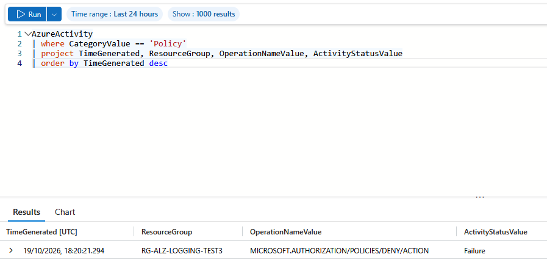

# Lab 04: Platform Management

## Overview

| | |
|---|---|
| **Goal** | Build the landing zone's management layer with Terraform: central logging, a subscription budget and group-based access at management group scope, then prove each one works |
| **Runs on** | Azure and Microsoft Entra ID, in UK South, with Terraform state in Azure Storage |
| **Cost** | Free in practice. Activity log data has no ingestion charge, and budgets and role assignments cost nothing |
| **Time** | About four hours, most of it investigating one missing log event |

Labs 01 to 03 built the structure, the rules and the network. This lab adds what a platform team needs to run it: **visibility** (who did what, and what was blocked), **cost control** (an early warning before spending gets out of hand) and **access management** (who can see what, granted once at the top).

The key test connects this lab to Lab 02: I triggered a policy denial and found it in the central logs with a KQL query.



---

## Architecture

```
Landing Zone (alz)  mg-alz
│   └── Reader role → grp-alz-platform-readers   (inherited by everything below)
│
└── Landing Zones → Corp → Azure subscription 1
        │
        ├── Activity log ──────────────►  law-alz-platform-uks
        │   (8 categories, including Policy)   Log Analytics workspace
        │                                      rg-alz-management-uks  (cost-centre = platform)
        │
        └── budget-alz-monthly: £20 a month
            Alerts at 50%, 80% and 100% actual, and 100% forecast → subscription Owners
```

| Resource | What it is for |
|---|---|
| `law-alz-platform-uks` | The central Log Analytics workspace, with 30-day retention and a 0.5 GB daily cap |
| `send-activity-log-to-law` | A diagnostic setting that sends the subscription's activity log to the workspace |
| `budget-alz-monthly` | A £20 monthly budget with four alert thresholds |
| `grp-alz-platform-readers` | A Microsoft Entra ID security group for read-only access |
| Reader at `mg-alz` | The group's role, assigned once at the top of the hierarchy |

### One subscription, playing every role

In a real landing zone, the workspace lives in a dedicated management subscription under **Platform → Management**, and every subscription sends its logs there. I have one subscription, so the workspace sits in it, in its own resource group tagged `platform`.

---

## Following along?

- I ran every command in **PowerShell** on Windows, using the terminal inside **VS Code**.
- Each command is in its own box. Run **one line at a time**.
- Boxes marked **What I saw** show my output. They are not commands to run.
- I have removed my subscription ID, tenant ID and workspace ID from every output.
- Times in logs are **UTC**. During British Summer Time, UK time is one hour ahead.
- This lab needs the management groups from [Lab 01](../lab-01-management-groups/README.md) and the policies from [Lab 02](../lab-02-policy/README.md).
- Creating the Entra ID group needs a directory role that can create groups. On a free trial you are the directory's Global Administrator.

See the [main README prerequisites](../README.md#prerequisites) for what to install.

---

## Files in this lab

| File | What it does |
|---|---|
| `providers.tf` | The `azurerm` provider for Azure and the `azuread` provider for Microsoft Entra ID |
| `backend.tf` | Stores Terraform state in Azure Storage, in its own state file |
| `variables.tf` | Region, retention, daily cap, log categories, budget amount and start date, and the group name, with validation |
| `logging.tf` | The resource group, workspace and activity log diagnostic setting |
| `budget.tf` | The monthly budget and its alerts |
| `access.tf` | The Entra ID group and its role assignment at `mg-alz` |
| `outputs.tf` | Names of everything built, and the role assignment's scope |

### Sending the activity log, from `logging.tf`

```hcl
# Send every subscription-level event to the workspace: creates, deletes,
# role changes, policy denials and service health
resource "azurerm_monitor_diagnostic_setting" "activity_log" {
  name                       = "send-activity-log-to-law"
  target_resource_id         = data.azurerm_subscription.current.id
  log_analytics_workspace_id = azurerm_log_analytics_workspace.platform.id

  dynamic "enabled_log" {
    for_each = toset(var.activity_log_categories)

    content {
      category = enabled_log.value
    }
  }
}
```

| Code | What it does |
|---|---|
| `target_resource_id = data.azurerm_subscription.current.id` | Attaches the setting to the subscription itself, so it captures the subscription's activity log |
| `dynamic "enabled_log"` | Writes one `enabled_log` block per category in the variable, instead of eight copies |
| `daily_quota_gb` (on the workspace) | Stops ingestion for the day once the cap is reached, so a noisy source cannot run up a bill |

### The budget, from `budget.tf`

```hcl
# One alert per threshold. Forecasted fires when Azure predicts the month will go over
locals {
  budget_alerts = {
    "actual-50"    = { threshold = 50, type = "Actual" }
    "actual-80"    = { threshold = 80, type = "Actual" }
    "actual-100"   = { threshold = 100, type = "Actual" }
    "forecast-100" = { threshold = 100, type = "Forecasted" }
  }
}

resource "azurerm_consumption_budget_subscription" "monthly" {
  name            = "budget-${var.prefix}-monthly"
  subscription_id = data.azurerm_subscription.current.id
  amount          = var.budget_amount
  time_grain      = "Monthly"

  time_period {
    start_date = var.budget_start_date
  }

  dynamic "notification" {
    for_each = local.budget_alerts

    content {
      enabled        = true
      threshold      = notification.value.threshold
      threshold_type = notification.value.type
      operator       = "GreaterThanOrEqualTo"

      # Alerts go to whoever holds the Owner role, so no email address is stored in code
      contact_roles = ["Owner"]
    }
  }
}
```

| Code | What it does |
|---|---|
| `threshold_type = "Forecasted"` | Warns when Azure predicts the month will go over budget, before the money is spent |
| `contact_roles = ["Owner"]` | Sends alerts to everyone with the Owner role. The recipients change with role membership, and no email address appears in a public repository |
| `amount` | Is in the billing account's currency, which for me is GBP |

A budget only sends alerts. It never stops or limits spending.

### Access, from `access.tf`

```hcl
# Access is granted to groups, not individual people
resource "azuread_group" "platform_readers" {
  display_name            = var.reader_group_name
  description             = "Read-only access to everything in the landing zone"
  security_enabled        = true
  prevent_duplicate_names = true
}

# Assigned once at the top of the hierarchy, inherited by every subscription below
resource "azurerm_role_assignment" "platform_readers" {
  scope                = data.azurerm_management_group.org.id
  role_definition_name = "Reader"
  principal_id         = azuread_group.platform_readers.object_id

  # A new group can take a minute to reach every part of Azure.
  # Declaring the type stops Azure rejecting the assignment in that gap
  principal_type = "Group"
}
```

| Code | What it does |
|---|---|
| `azuread_group` | Creates the group in Microsoft Entra ID, using the second provider |
| `prevent_duplicate_names = true` | Fails instead of creating a second group with the same name |
| `scope = data.azurerm_management_group.org.id` | Assigns the role at `mg-alz`, so it applies to every management group and subscription beneath it |
| `principal_type = "Group"` | Lets Azure accept the assignment before the new group has replicated everywhere. My first apply succeeded without a retry |

---

## How I built it

### Step 1: Checked I had what the lab needs

```powershell
az rest --method get --url "https://graph.microsoft.com/v1.0/me/memberOf" --query "value[].displayName" -o tsv
```

```
Global Administrator
```

```powershell
az consumption budget list -o table
```

This returned no budgets and no error, so the free trial supports budgets.

```powershell
az provider show --namespace Microsoft.OperationalInsights --query registrationState -o tsv
```

I ran the same check for `Microsoft.Insights` and `Microsoft.Consumption`. All three were `Registered`.

### Step 2: Created the folder

```powershell
cd C:\azure-landing-zone
```

```powershell
New-Item -ItemType Directory -Path lab-04-management
```

```powershell
Copy-Item lab-02-policy\backend.tf -Destination lab-04-management
```

```powershell
(Get-Content lab-04-management\backend.tf) -replace 'alz-lab02-policy.tfstate', 'alz-lab04-management.tfstate' | Set-Content lab-04-management\backend.tf
```

I wrote `providers.tf` fresh rather than copying it, because this lab adds the `azuread` provider.

### Step 3: Initialised, validated and planned

```powershell
cd C:\azure-landing-zone\lab-04-management
```

```powershell
terraform init
```

**What I saw** (shortened):

```
- Installed hashicorp/azurerm v4.81.0 (signed by HashiCorp)
- Installed hashicorp/azuread v3.10.0 (signed by HashiCorp)

Terraform has been successfully initialized!
```

```powershell
terraform validate
```

```powershell
terraform plan -out=tfplan | Select-String "will be created", "Plan:"
```

```
  # azuread_group.platform_readers will be created
  # azurerm_consumption_budget_subscription.monthly will be created
  # azurerm_log_analytics_workspace.platform will be created
  # azurerm_monitor_diagnostic_setting.activity_log will be created
  # azurerm_resource_group.management will be created
  # azurerm_role_assignment.platform_readers will be created
Plan: 6 to add, 0 to change, 0 to destroy.
```

### Step 4: Applied

```powershell
terraform apply tfplan
```

**What I saw:**

```
Apply complete! Resources: 6 added, 0 changed, 0 destroyed.

Outputs:

budget_name = "budget-alz-monthly"
reader_group = "grp-alz-platform-readers"
reader_role_scope = "/providers/Microsoft.Management/managementGroups/mg-alz"
workspace_customer_id = "<workspace-id>"
workspace_name = "law-alz-platform-uks"
```

---

## Tests I carried out

### Test 1: Find a policy denial in the central logs

I triggered the same denial as Lab 02's first test, a resource group outside the UK:

```powershell
az group create --name rg-alz-logging-test3 --location westeurope --tags cost-centre=lab --query name -o tsv
```

```
(RequestDisallowedByPolicy) Resource 'rg-alz-logging-test3' was disallowed by policy. Reasons: 'Resource groups must be created in an approved region: uksouth, ukwest.'.
```

Then I queried the workspace with KQL. I loaded the workspace ID into a variable so it stayed off the screen:

```powershell
$wsId = terraform output -raw workspace_customer_id
```

```powershell
az monitor log-analytics query --workspace $wsId --analytics-query "AzureActivity | where CategoryValue == 'Policy' | project TimeGenerated, ResourceGroup, OperationNameValue, ActivityStatusValue | order by TimeGenerated desc" -o table
```

**What I saw:**

```
ActivityStatusValue    OperationNameValue                            ResourceGroup         TimeGenerated
---------------------  --------------------------------------------  --------------------  ----------------------------
Failure                MICROSOFT.AUTHORIZATION/POLICIES/DENY/ACTION  RG-ALZ-LOGGING-TEST3  2026-10-19T18:20:21Z
```

A guardrail from Lab 02 blocked the request, and the central logs recorded it. A platform team can now answer "who tried to do what, and what stopped them" from one place.

The same event is written differently in the two places I looked:

| In Azure's activity log | In Log Analytics |
|---|---|
| `Failed` | `Failure` |
| `rg-alz-logging-test3` | `RG-ALZ-LOGGING-TEST3` |

So I use `=~`, which ignores case, when matching names in KQL. This was my third attempt. See [Issue 1](#1-the-first-policy-denial-never-reached-the-workspace).

### Test 2: The budget

```powershell
az consumption budget show --budget-name budget-alz-monthly --query "{Amount:amount, Grain:timeGrain, SpentSoFar:currentSpend.amount, Currency:currentSpend.unit}" -o json
```

**What I saw:**

```json
{
  "Amount": "20.0",
  "Currency": "GBP",
  "Grain": "Monthly",
  "SpentSoFar": "0.0"
}
```

The budget is in pounds. `SpentSoFar` was still `0.0` on a budget a few minutes old, because cost data takes hours to reach Cost Management.

### Test 3: RBAC inheritance

I kept the subscription and group IDs in variables, so they stayed off the screen:

```powershell
$subId = az account show --query id -o tsv
```

```powershell
$grpId = az ad group show --group grp-alz-platform-readers --query id -o tsv
```

```powershell
az role assignment list --assignee $grpId --scope "/subscriptions/$subId" --include-inherited --query "[].{Role:roleDefinitionName, AssignedAt:scope}" -o table
```

**What I saw:**

```
Role    AssignedAt
------  -------------------------------------------------------
Reader  /providers/Microsoft.Management/managementGroups/mg-alz
```

I asked about the **subscription**, and Azure answered that the group has Reader there, assigned at `mg-alz`, two levels up. Role assignments are inherited down the hierarchy in the same way as the policies in Lab 02.

### Test 4: Someone removes the access by hand

```powershell
az role assignment delete --assignee $grpId --role Reader --scope "/providers/Microsoft.Management/managementGroups/mg-alz"
```

```powershell
terraform plan
```

Terraform planned to create the role assignment again, because its state said it should exist and Azure said it did not. I put it back:

```powershell
terraform apply -auto-approve
```

```
Apply complete! Resources: 1 added, 0 changed, 0 destroyed.
```

Running Test 3 again showed the `Reader` row once more. Access granted through code is restored by code if someone removes it by hand.

| Test | Expected | Result |
|---|---|---|
| 1. Policy denial in the logs | Found with KQL | ✅ On the third attempt |
| 2. Budget | £20 a month | ✅ `GBP` |
| 3. RBAC inheritance | Reader visible at the subscription, assigned at `mg-alz` | ✅ |
| 4. Access drift | Detected and restored | ✅ `1 added` |

---

## Issues I hit and how I fixed them

### 1. The first policy denial never reached the workspace

**Symptom.** My first test denial, at 15:02 UTC, appeared in Azure's activity log but never in the workspace, even three hours later.

```powershell
az monitor activity-log list --offset 1h --query "[?category.value=='Policy'].{Time:eventTimestamp, Operation:operationName.value, Status:status.value, Group:resourceGroupName}" -o table
```

```
Time                          Operation                                     Status    Group
----------------------------  --------------------------------------------  --------  -------------------
2026-10-19T15:02:33.7586683Z  Microsoft.Authorization/policies/deny/action  Failed    rg-alz-logging-test
```

**Investigation.** I checked each link in the chain separately:

| Check | Result |
|---|---|
| The diagnostic setting | All 8 categories enabled, including `Policy` |
| Workspace errors, in the `_LogOperation` table | None |
| A search of every table for the resource group's name | Nothing |
| A new resource group created and deleted at 17:50 | Its `Administrative` events arrived within 10 minutes |
| A second denial at 18:20 | Arrived in the workspace |

**Conclusion.** Delivery works for both normal events and policy denials. Only the first denial, made about 13 minutes after the workspace and diagnostic setting were created, never arrived. I found no documentation that explains it, so I am recording what I observed rather than guessing a cause.

**Lesson.** When you are investigating something that has just happened, check the activity log directly as well as Log Analytics. Do not treat a missing log entry as proof that something did not happen.

### 2. I expected role assignment changes in the subscription's logs

**Symptom.** After Test 4, I expected the role assignment's deletion and re-creation in the workspace. They never appeared.

**Root cause.** The role is assigned at `mg-alz`, a management group, so Azure records changes to it in the **management group's** activity log. The diagnostic setting in this lab sends only the **subscription's** activity log.

**Lesson.** Each scope has its own activity log. Capturing changes to management groups needs a diagnostic setting on the management groups too.

### 3. The portal ran a different query from mine

**Symptom.** In the workspace's **Logs** page, my query returned `No results found from the last 24 hours`.

**Root cause.** The page first opened in a new AI agent view. After I switched to the query editor, a suggested query had been added below mine. Log Analytics treats a blank line as the boundary between queries and runs only the query where the cursor is, and my cursor was in the suggested one.

**Fix.** I switched the **Agent** toggle off, cleared the editor with **Ctrl+A**, pasted only my query and ran it.

### 4. UTC and UK time

Log timestamps are in UTC. In October, UK time is UTC + 1 hour, so at first I underestimated how long I had been waiting for Issue 1 by an hour. I now convert times before comparing a log with the clock.

---

## Clean up

These resources stay in place until the end of the project, because they cost nothing to keep. When I remove the landing zone, I run `terraform destroy` in the reverse order of building it: Lab 04, then Lab 02, then Lab 01, and finally the state storage.

---

## Command reference

| Command | What it does |
|---|---|
| `az monitor log-analytics query --workspace <id> --analytics-query "<KQL>"` | Runs a KQL query against a workspace. It needs the `log-analytics` CLI extension, which Azure CLI offers to install |
| `az monitor activity-log list --offset 1h` | Reads the activity log directly from Azure, without going through a workspace |
| `az monitor diagnostic-settings subscription list` | Lists the subscription's activity log diagnostic settings |
| `az consumption budget show --budget-name <name>` | Shows a budget and the spend so far |
| `az role assignment list --assignee <id> --scope <scope> --include-inherited` | Lists role assignments, including those inherited from above |
| `az ad group show --group <name>` | Shows an Entra ID group |

| KQL | What it does |
|---|---|
| `AzureActivity` | The table that holds activity log events |
| `where CategoryValue == 'Policy'` | Keeps only policy events |
| `=~` | Compares text without caring about upper or lower case |
| `project` | Chooses which columns to show |
| `distinct CategoryValue` | Lists each category that has arrived |
| `search 'text'` | Searches every table for some text |

## What I learned

- Central logging is only useful if you can query it. KQL turned "was anything blocked?" into one query.
- Log Analytics is not real time, and an event can be missing. The activity log is the first place to check for something that has just happened.
- Every scope has its own activity log. A subscription's diagnostic setting does not capture changes made at management group level.
- A budget warns but never stops spending, and sending alerts to a role keeps personal details out of code.
- Role assignments are inherited exactly like policies, so access is granted once at the top and to groups, not individual people.
- Terraform detects and restores access removed by hand, just as it restored the management group placement in Lab 01.

---

## References

Official documentation I used while building and testing this lab.

| What I did | Documentation |
|---|---|
| Sent the activity log to the workspace and checked its cost | [Activity log in Azure Monitor](https://learn.microsoft.com/en-us/azure/azure-monitor/platform/activity-log) |
| Understood the Policy category and deny events | [Azure activity log event schema](https://learn.microsoft.com/en-us/azure/azure-monitor/essentials/activity-log-schema) |
| Configured the diagnostic setting | [Diagnostic settings in Azure Monitor](https://learn.microsoft.com/en-us/azure/azure-monitor/platform/diagnostic-settings) |
| Created the budget and its alerts | [Tutorial: Create and manage budgets](https://learn.microsoft.com/en-us/azure/cost-management-billing/costs/tutorial-acm-create-budgets) |
| Assigned the role at management group scope | [Understand scope for Azure RBAC](https://learn.microsoft.com/en-us/azure/role-based-access-control/scope-overview) |
| Built the workspace with Terraform | [azurerm_log_analytics_workspace](https://registry.terraform.io/providers/hashicorp/azurerm/latest/docs/resources/log_analytics_workspace) |
| Built the diagnostic setting with Terraform | [azurerm_monitor_diagnostic_setting](https://registry.terraform.io/providers/hashicorp/azurerm/latest/docs/resources/monitor_diagnostic_setting) |
| Built the budget with Terraform | [azurerm_consumption_budget_subscription](https://registry.terraform.io/providers/hashicorp/azurerm/latest/docs/resources/consumption_budget_subscription) |
| Created the group with Terraform | [azuread_group](https://registry.terraform.io/providers/hashicorp/azuread/latest/docs/resources/group) |
| Assigned the role with Terraform | [azurerm_role_assignment](https://registry.terraform.io/providers/hashicorp/azurerm/latest/docs/resources/role_assignment) |
| Generated repeated blocks | [dynamic blocks](https://developer.hashicorp.com/terraform/language/expressions/dynamic-blocks) |